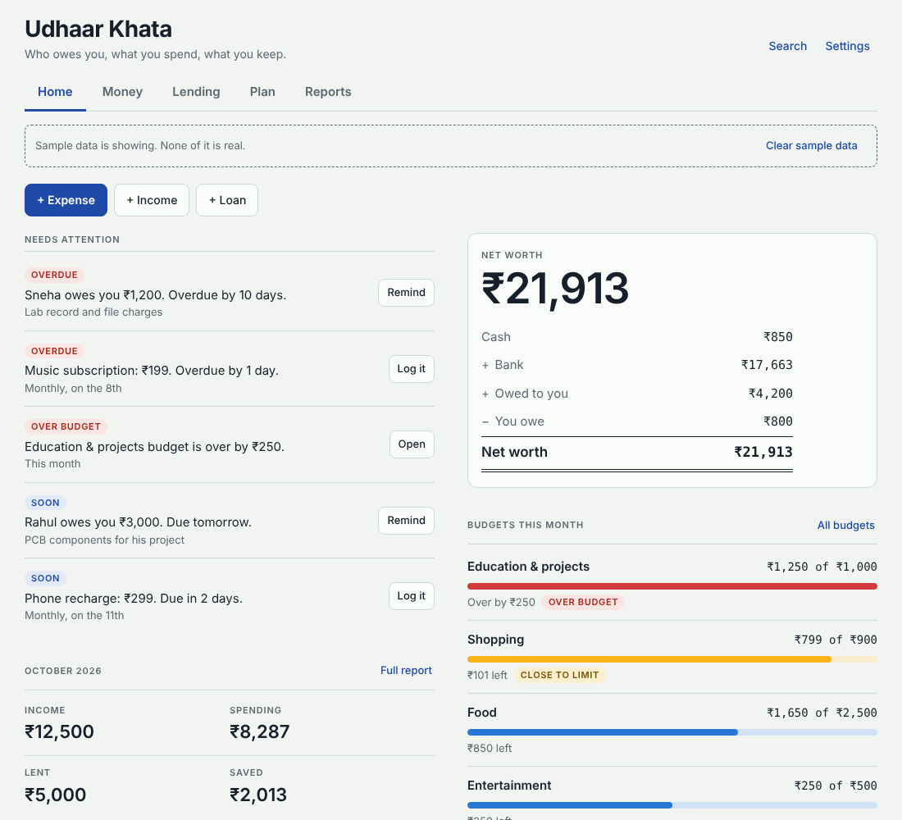
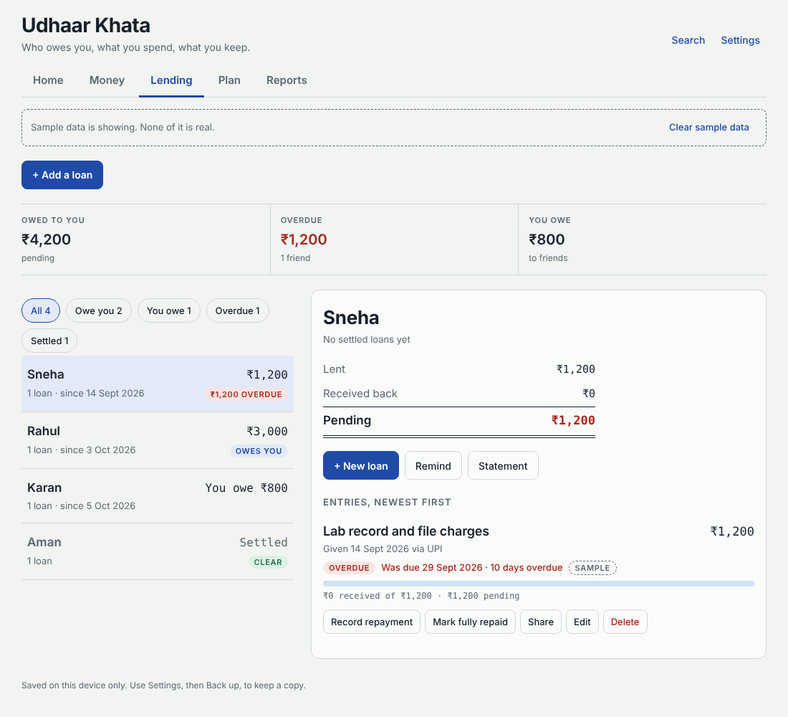
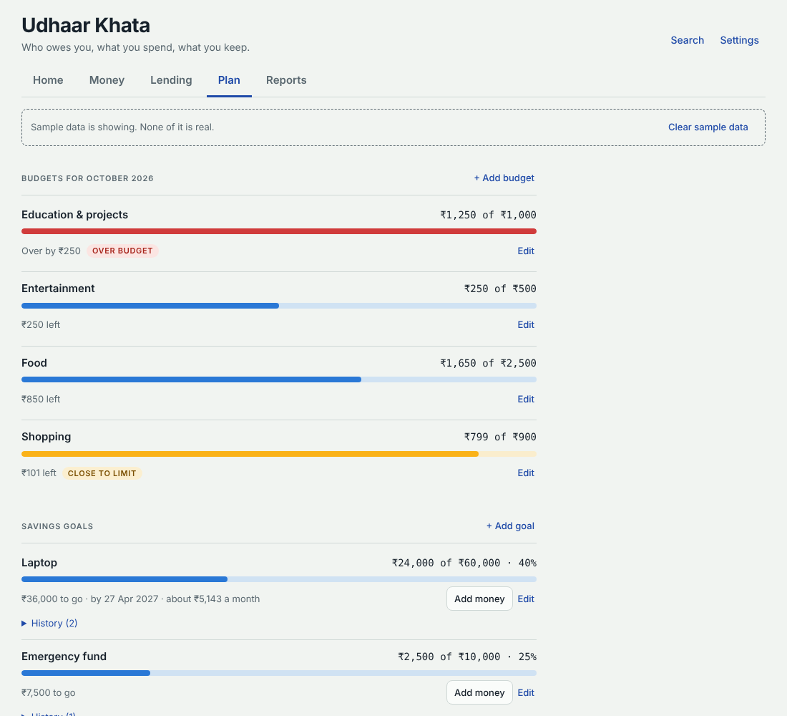
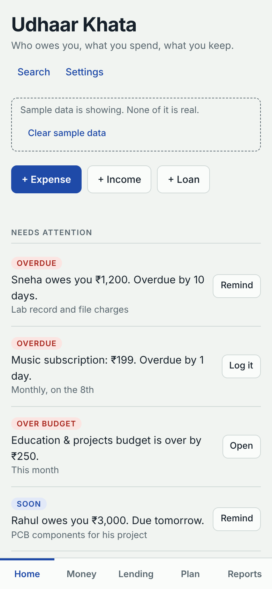
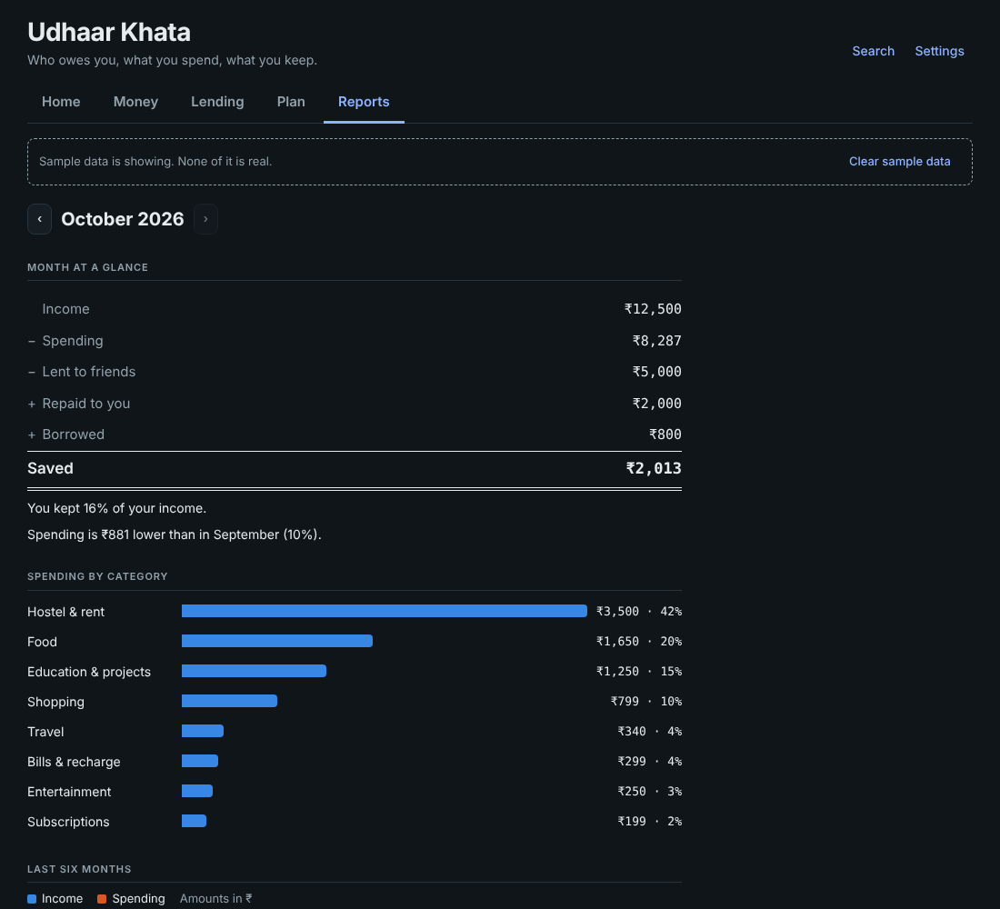
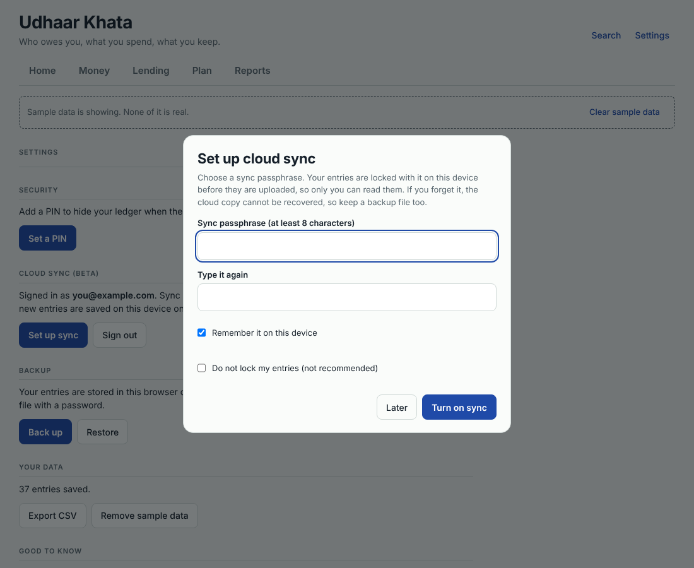
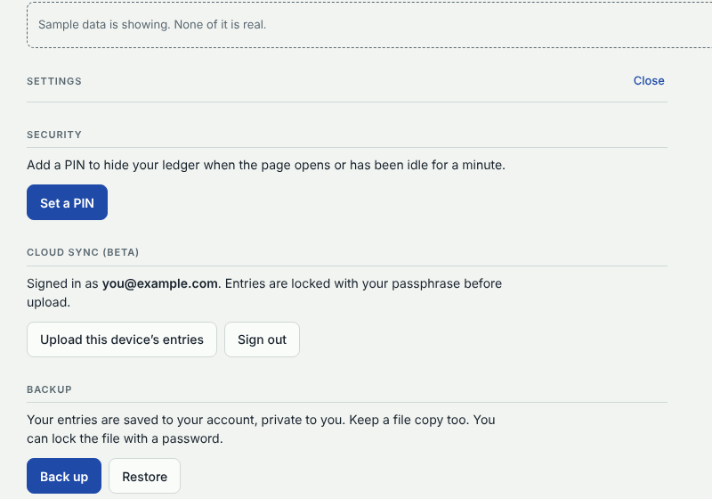

# Udhaar Khata

[](https://github.com/Karthikeya2005/udhaar-khata/actions/workflows/test.yml)
[](LICENSE)


A personal-finance ledger that started as a lending tracker.

It remembers **who you lent money to, why, and when**, so nobody can say "what money?" later. It also covers everyday money: spending, budgets, savings goals, recurring payments, net worth and monthly reports. Sign in with Google and the same ledger follows you across your phone and computer, locked with a passphrase only you know.

**Live app:** <https://karthikeya2005.github.io/udhaar-khata/>

It is plain HTML, CSS and JavaScript with no build step, and installs on a phone as a PWA.



## Features

**Lending and borrowing**
- Every loan keeps a reason, date and due date. Money you owe a friend is tracked the same way.
- Repayment tracking: ₹5,000 lent → ₹2,000 returned → ₹3,000 remaining.
- Share a transaction or a full statement with a friend on WhatsApp.
- Reminders: "Rahul owes you ₹3,000. Due tomorrow."

**Everyday money**
- Income and spending with categories, plus cash and bank balances.
- Monthly budgets with used and remaining, and a warning when you get close.
- Savings goals with progress.
- Recurring payments (rent, hostel, subscriptions, recharge). You confirm each one; nothing is posted automatically.
- Net worth: cash + bank + money owed to you − money you owe.
- Monthly reports with a 6-month trend and category breakdown.
- Search by name, reason, category, month or amount (`Rahul`, `PCB`, `October`, `₹2000`).

**Sync, backup and security**
- **Cloud sync (optional):** sign in with Google, and your ledger syncs across devices through your own free Firebase project.
- **Passphrase lock:** entries are encrypted on your device (AES-GCM) before upload, so the database holds only scrambled text.
- **Works offline** and syncs when you reconnect.
- PIN lock for the screen.
- Encrypted backup and restore files.
- CSV export of loans and transactions.

## Screenshots

| Lending: reasons, repayments, statements | Plan: budgets, goals, recurring |
|---|---|
|  |  |

| Phone | Reports (dark mode) |
|---|---|
|  |  |

| Turn on cloud sync | Signed in and synced |
|---|---|
|  |  |

## How the numbers work

- **Account balance** = opening balance + income − spending − money lent + repayments received (and the reverse for money you borrow).
- **Net worth** = cash + bank balances + money owed to you − money you owe.
- **Saved (month)** = income − spending − lent + repaid.
- **Goals** are earmarks inside your balances, not extra money, so they don't change net worth.
- **Recurring payments** only create a transaction when you tap Log.

## Try it locally

```bash
git clone https://github.com/Karthikeya2005/udhaar-khata.git
cd udhaar-khata
python -m http.server 3000     # or: npm start
```

Open <http://localhost:3000>. Tap **Load sample data** to explore, and **Clear sample data** when done. Serve it over http rather than opening `index.html` directly, because the sync module does not load from `file://`.

## Cloud sync

Cloud sync is optional. Without it the app stores data on each device only.

To turn it on, create a free Firebase project, enable Google sign-in and Firestore, publish [`firestore.rules`](firestore.rules), and paste your web config into [`firebase-config.js`](firebase-config.js). The full walkthrough is in [docs/FIREBASE_SETUP.md](docs/FIREBASE_SETUP.md).

How it works:

```
 your device                                   Firebase (free Spark plan)
┌──────────────────────┐   encrypted (AES-GCM)  ┌──────────────────────────┐
│ app.js               │ ─────────────────────▶ │ Firestore                │
│  • passphrase → key  │                        │  users/<uid>/items/*     │
│  • seals each entry  │ ◀───────────────────── │  users/<uid>/meta/crypto │
└──────────────────────┘      realtime sync     └──────────────────────────┘
        ▲                                         rules: only <uid> can read/write
        └── Google sign-in (Firebase Auth)
```

- **Login** decides who can reach the data. The rules allow a user to read and write only `users/<their own id>`.
- **Passphrase** decides who can read it. The key is derived on your device (PBKDF2, 200,000 rounds) and never uploaded. Forget it and the cloud copy cannot be recovered, so keep a backup file.
- The Firebase web config is a public identifier, safe to commit. The rules and your passphrase are the real protection.

## Install on Android

1. Open the live app in Chrome on your phone.
2. Menu (⋮) → **Install app** or **Add to Home screen**.

It then opens full-screen like a normal app and works offline.

For a real `.apk`, paste the live URL into [PWABuilder](https://www.pwabuilder.com) and choose Android. It packages the PWA as a Trusted Web Activity. If Google sign-in misbehaves inside the APK, use the Chrome-installed app instead.

## Deploy on GitHub Pages

1. Push the repo to GitHub.
2. **Settings → Pages → Deploy from a branch → `main` / `(root)`**.
3. Add `<your-username>.github.io` to Firebase **Authentication → Settings → Authorized domains** if you use sync.

## Data and privacy

| | Local only (default) | With cloud sync |
|---|---|---|
| Where entries live | This browser's `localStorage` (`udhaar-khata.v2`) | Your own Firebase project, encrypted |
| Who can read them | Anyone using this browser profile | Only you: Google login plus your passphrase |
| PIN | PBKDF2-hashed screen lock, kept on this browser | Same |
| Backups | AES-GCM encrypted files (optional password) | Same |

Network requests: Google Fonts, plus Firebase only when sync is configured.

## Limits (honest ones)

- No push notifications. Reminders show when you open the app.
- No fingerprint or face unlock. The PIN is a screen lock, not encryption of the stored data.
- Without sync, data lives in one browser on one device. Back up regularly.
- If you forget your sync passphrase, the cloud copy cannot be recovered.
- Sync is beta. Entries are last-write-wins, so editing the same entry on two devices at once keeps the later save.

## Tests

```bash
npm install
npx playwright install chromium
npm test           # end-to-end checks + a mock-cloud sync test (no Firebase account needed)
npm run shots      # regenerates the screenshots in docs/
```

CI runs the same tests on every push (`.github/workflows/test.yml`).

## Project structure

```
index.html              app shell
styles.css              styles (light and dark)
app.js                  all logic and views
sync.js                 Firebase adapter (optional)
firebase-config.js      your Firebase web config (empty = local only)
firestore.rules         security rules to publish in Firebase
sw.js                   offline service worker
manifest.webmanifest    PWA manifest
icons/                  app icons
tests/e2e.js            end-to-end tests
tests/sync.js           cloud sync tests against a mock backend
tests/shots.js          screenshot generator
docs/                   screenshots and the Firebase setup guide
.github/workflows/      CI
```

## Ideas for later

- Per-friend PDF statement
- Receipt or screenshot attached to a loan
- Push reminders (Firebase Cloud Messaging)
- Parse UPI/bank SMS into transactions
- Repayment-likelihood score per friend
- Shared expenses with friends

## Licence

MIT, see [LICENSE](LICENSE).
